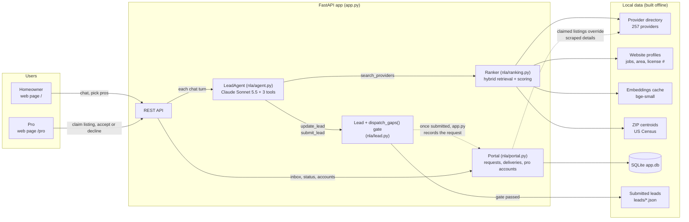
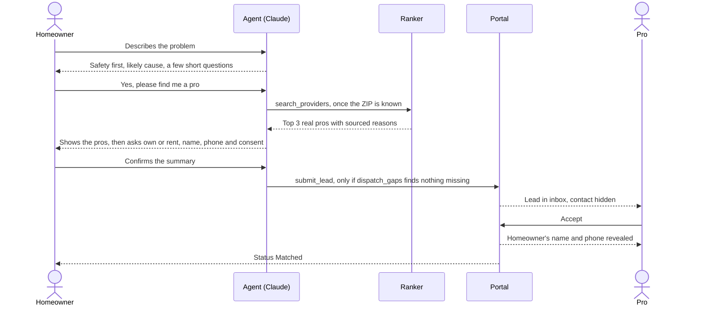
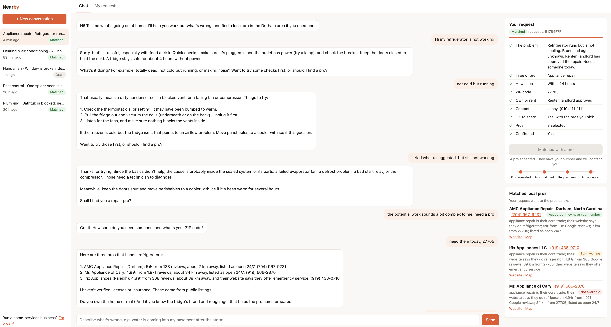
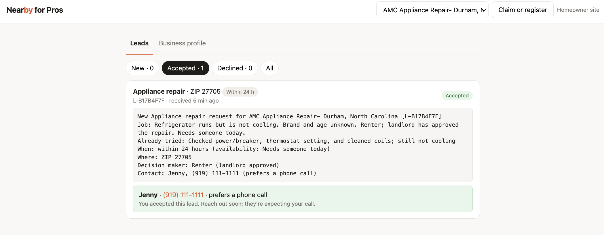
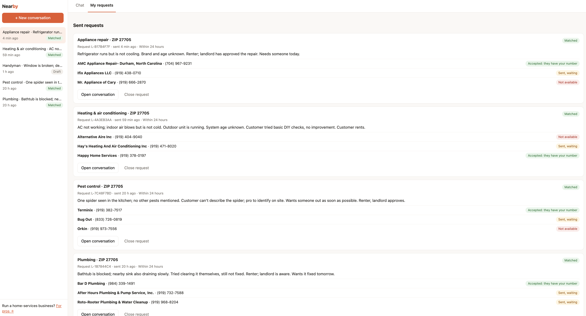
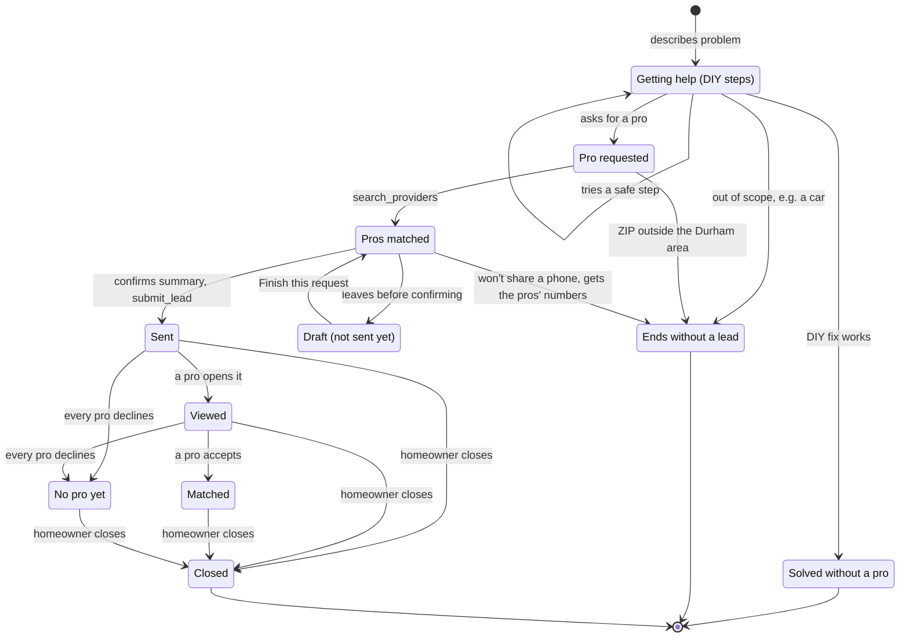
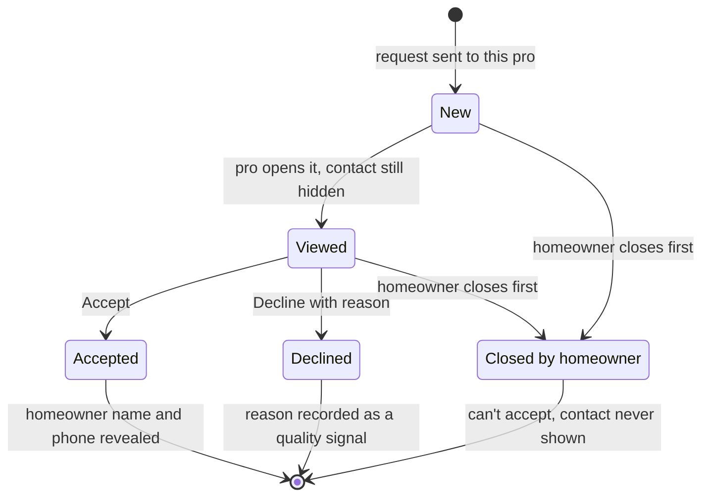

# Nearby AI Agent: Durham, NC

**▶ [Watch the demo video](https://youtu.be/qom40EYgyPo)**

A conversational agent that helps Durham homeowners figure out what's wrong in their home, offers a pro only when they want one, and turns the conversation into a dispatchable lead that real local providers would accept and act on.

It's built around the two metrics we care most about:
- **Conversion rate:** the share of conversations that end in a dispatchable lead ([what counts as dispatchable](#what-counts-as-a-dispatchable-lead)).
- **Lead quality:** whether a real provider would accept the lead and act on it.

## Results at a glance

| | |
|---|---|
| **Conversion rate** | **89% (17/19)** of simulated homeowners who want a pro end with a dispatchable lead, even though the agent offers a pro only when asked. **4 of 4** homeowners open to DIY were helped to a fix without a pushed lead. |
| **Lead quality** | **100% (17/17)** of leads would be paid for and acted on by an LLM judge playing the provider. Its mean score is 3.4 of 5: workable, though the pro would still call to ask about timing and price. Trade, urgency, ZIP and phone are correct in every lead, with **0 of 5** false leads on out-of-scope, out-of-area and DIY-only scenarios. |
| **Providers** | 257 real Durham-area businesses, every row spot-checkable in [data/PROVIDERS.md](data/PROVIDERS.md). Sources: Google Places + hand research + 185 provider websites read into structured profiles. Duplicate listings merged; 7 non-residential listings excluded. |
| **Ranking** (47 needs, judge-labeled) | NDCG@3 **0.88**, up from 0.51 for a trade-and-rating baseline. 98% of top-3 picks rated good or excellent. Search takes 12 ms. With the opt-in LLM reranker: 0.95, at about 3 s per search. |
| **Main findings** | The remaining conversion loss is bypass: the homeowner calls a matched pro directly. Raw conversion fell from 68% to 58% when the agent stopped pushing; the cause turned out to be an eval that never said whether the homeowner wanted a pro. See [Results](#results). |

The conversation numbers come from 30 simulated homeowners. Method and caveats are in [Evaluation](#evaluation-eval) and [Ranking eval](#ranking-eval-evalranking).

**Where to look**
- **See it work:** the [demo video](https://youtu.be/qom40EYgyPo) at the top, and the [App demo](#app-demo) screenshots of both sides. [DEMO.md](DEMO.md) is Nearby's own basement example, end to end, with the exact message each provider receives and the provider judge's verdict.
- **How it fits together:** [How it works](#how-it-works).
- **Why it's built this way:** [Key design trade-offs](#key-design-trade-offs), a summary at the end.

## Quick start

```bash
pip install -r requirements.txt
cp .env.example .env        # then open .env and paste your ANTHROPIC_API_KEY
                            # (GOOGLE_MAPS_API_KEY is optional; only data/build_places.py uses it)

python cli.py                         # chat in the terminal
python -m uvicorn app:app --port 8000 # homeowner app: http://localhost:8000
                                      # pro portal:    http://localhost:8000/pro
                                      # developer view (homeowner app + lead JSON and dispatch checks): http://localhost:8000/?debug=1
python tests/test_offline.py          # offline tests, no API key needed
python eval/run_eval.py               # conversation eval: 30 scenarios → eval/results/<ts>/report.md
python eval/run_eval.py --repeats 3   # variance across runs
python eval/ranking/run_ranking_eval.py   # ranking eval: 47 needs × 7 ranking systems → eval/ranking/report.md
```

The provider data is already built and committed. To rebuild it:

```bash
python data/build_seed.py                    # 43 hand-researched seed rows
python data/build_places.py --run --fresh    # Google Places (needs GOOGLE_MAPS_API_KEY; ~20 calls, capped)
python data/build_profiles.py crawl          # each provider's website: homepage + up to 2 service pages
python data/build_profiles.py extract        # Claude Haiku → structured profile per provider ($0.19 for all 185)
```

The first search downloads a small local embedding model (`BAAI/bge-small-en-v1.5`, ~130 MB, via fastembed). Set `NLA_RERANK=1` to add the LLM reranker to live chat.

The model defaults to `claude-sonnet-5-5`. You can override it with `NLA_MODEL`. The simulator and judge models are set with `NLA_SIM_MODEL` and `NLA_JUDGE_MODEL`.

## How it works

**System overview.** Claude runs the conversation, and code enforces the rules: it can change anything only through three tools, and a lead can't be sent until the `dispatch_gaps()` check passes.



### What counts as a dispatchable lead

This is the `dispatch_gaps()` gate in the diagram (`nla/lead.py`). A lead is dispatchable when a provider can act on it without calling back just to learn what the job is. `submit_lead` refuses to send a lead until it has all of these:

1. A trade from the taxonomy, so it reaches the right kind of business.
2. A concrete problem summary: what, where, since when, and what's been tried.
3. Urgency.
4. A ZIP code inside the served Durham-area ZIPs.
5. Name, a valid US phone number, and explicit consent to share them.
6. Authority over the work: owner, renter with approval, or renter who still needs approval (flagged to the provider).
7. At least one matched provider that `search_providers` actually returned. The model can't make one up.
8. The user's confirmation of the summary before sending.

The model handles the conversation, and code enforces what counts as a lead. A prompt regression can lower conversion, but it can't produce a junk lead.

### A request, end to end

*Simplified.* The agent helps first and searches only after the homeowner asks for a pro. A pro sees the homeowner's contact only after accepting.



## The app: both sides of the marketplace

`app.py` serves two pages from one process. State lives in SQLite (`data/app.db`, created on first run; logic in `nla/portal.py`).

### App demo

The screenshots below follow one request, from the homeowner's first message to a pro accepting it. The providers are real Durham-area businesses; the homeowner's details are made up.

**1. The homeowner's chat: "my refrigerator is not working".**



- **Help first; a pro only when the homeowner asks.** How the agent offers a pro depends on the situation:
  - **Simple jobs** (a fridge not cooling, a slow drain): 1–3 safe DIY steps, then one choice question. Here: check the plug, the outlet and the breaker, keep the doors closed, then "Want to try some checks first, or should I find a pro?" Once the homeowner says it runs but isn't cold, the agent names the likely causes (dirty coils, a blocked vent, a fan) and suggests three more checks.
  - **A DIY step that didn't work:** it says what that tells it and offers the next safe step, or explains why it now needs a pro, then asks again. A failed attempt isn't treated as a request. Here: after the checks fail, it explains that the cause is likely inside the sealed system (an evaporator fan, defrost, a start relay or the compressor), which needs a technician. It adds what to do meanwhile (keep the doors shut, move food to a cooler), then asks "Shall I find you a repair pro?"
  - **Emergencies and hazards** (flooding, gas, sparks): safety steps first, then "This needs a pro today. Want me to find a 24/7 company now?"
  - It never starts pro intake (ZIP, contact details) until the homeowner says yes, and code blocks the provider search until then.
- **"Find me a pro now" button:** a one-tap choice for homeowners who'd rather skip DIY. Once a pro is requested, it turns into the status tracker on the right (here: "Matched with a pro").
- **Once the homeowner asks** ("I need a pro"), the agent:
  - asks how soon and the ZIP
  - shows three real appliance-repair companies, each with sourced reasons (rating, distance, listed as open 24/7 or the website offers emergency service), and says plainly that licenses and insurance aren't verified
  - asks own or rent, plus one optional question so the pro comes prepared (the fridge's brand and rough age)
  - asks for contact details last, and confirms the summary before sending
- **On the right:** the request checklist, the status tracker, and each matched pro with their answer.
- **Why two pros are 34–39 km away.** The homeowner needs someone today, so the search counts as an emergency, and a pro listed as 24/7 or offering emergency service gets a large boost. That boost outweighs distance. Without the urgency, the same search ranks two closer shops (6–7 km) near the top instead. How much 24/7 availability should outweigh distance for urgent jobs is a weight worth tuning once real accept data shows how far pros will actually travel.

**2. A pro accepts.**



- AMC Appliance Repair sees the job brief: the problem, what was already tried, when, where, and who can approve the work.
- The homeowner's phone number appears only after the pro accepts. A pro who hasn't accepted only sees "Phone shown once you accept".

**3. The homeowner's requests.**



- Each sent request shows each pro's answer: accepted ("they have your number"), still waiting, or not available.
- **When a pro declines,** they must pick a reason (not my trade, too far, too small, fully booked, not enough info). The homeowner sees only "Not available"; the reason stays with Nearby as a quality signal.
- **The sidebar** keeps every conversation with its status, including an unsent draft.

### What each side can do

**Homeowner (`/`)**
- **Chat history sidebar.** Conversations are saved with the agent's full state, so a chat resumes even after a server restart.
- **Live "Your request" checklist,** with a **"Find me a pro now"** button for users who don't want to try fixing it themselves. The button posts a visible message as the user and records the explicit request.
- **Matched-pro cards** show each pro's public phone and the sourced reasons. A checkbox per pro sets who receives the request. This answers a conversion loss seen in the eval: a user who wanted only one specific pro. The agent is told about checkbox changes on the next turn.
- **"My requests" tab:**
  - Each sent request shows its status (*Sent → Viewed → Matched*, or *No pro yet*) and each pro's answer.
  - Drafts that got as far as matching but were never sent get a "Finish this request" button, which recovers the "waiting for my landlord" case.
- **Developer view** at http://localhost:8000/?debug=1. It's the same homeowner page with one extra card in the right column: the dispatch checks still failing (what the lead still needs before it can be sent) and the full lead JSON, both updated after every turn. Homeowners never see it.

**Pro (`/pro`)**
- **Claim your listing.** Search by phone or name across the 257 providers. The form is pre-filled from Google and the provider's website (jobs, license number, with quotes as evidence). The pro confirms trades, specific jobs, service radius, 24/7, insurance and license board + number.
  - The license stays *submitted, not verified*.
  - Claimed details take effect in matching straight away, and are labeled as self-reported ("the business says it does…").
- **Register a new business** if it isn't listed. It enters the ranking with no reviews, matched on trade, jobs and distance.
- **Lead inbox** (New / Accepted / Declined):
  - Opening a lead marks it *viewed*.
  - **Accept** reveals the homeowner's name and phone.
  - **Decline** requires a reason: not my trade, too far, too small, fully booked, not enough info, other.

**Privacy rule (enforced in the API, not just the page).** A pro sees the job brief but not the homeowner's contact until that pro accepts. A pro's phone is public (it's on their Google listing), so homeowners always see it. This is a demo with no login: a pro picks their business, so the API keeps contacts hidden until accept, but nothing yet stops someone from acting as any listing. Real pro accounts are the step before production.

**Why decline reasons matter.** They're the real lead-quality signal the LLM judge stands in for: whether the lead was wrong ("not enough info") or the match was wrong ("not my trade", "too far"). Accept rate and decline reasons per provider are the transaction-backed reputation features the ranker would learn from (see "What I'd build next").

### Request and lead states

What the homeowner sees for their request:



And each pro's copy of the lead. An answer is final, and a closed request can't be accepted. The API enforces both.



## How the agent behaves, by metric

*What the agent does in a conversation, grouped by the metric each behavior serves. For the choices that cost something, and why they're worth it, see [Key design trade-offs](#key-design-trade-offs) below.*

**For conversion:**
- **A pro only when the user asks (Nearby's principle), enforced in code.** The lead has a `wants_pro` flag. It's set only when the user says they want a pro, says yes to the agent's offer, or taps "Find me a pro now" in the app. `search_providers` refuses to run until then. A failed DIY attempt is not a request: the agent offers the next safe step or explains why it now needs a pro, and asks. Emergencies get safety steps plus a direct "want me to find a 24/7 company now?".
- **Give value before asking for anything.** The first reply names the likely cause and one thing to do now ("move boxes off the floor, photograph for insurance"), then asks one question.
- **Ask few, short questions per turn:** usually one, at most two that naturally go together (such as ZIP and own-or-rent). Lead with the question that most changes who should come out. A routing playbook in `nla/taxonomy.py` covers the ambiguous cases. For basement water: is there standing water now (restoration), did it come from a pipe or pump (plumbing), or does it seep in every rain (waterproofing)?
- **Infer instead of asking.** "Last night after the storm" already means urgent, and a basement means a house.
- **Ask for contact details last,** after showing 2–3 named, real matches, each with a one-line reason. This is when the user has the most reason to trust the request.
- **One combined ask for contact details:** name, phone, call or text, and consent in a single turn, rather than four separate questions.

**Result:** 89% (17/19) of homeowners who want a pro end with a dispatchable lead, in a median of 6 turns. The remaining losses are bypass and impatience (see [Results](#results)).

**For lead quality:**
- **Trade routing is explicit,** and a `secondary_trade` field covers two-trade jobs (for example, extract the water today, then waterproof).
- **Faithfulness.** The summary and `user_facts` may only contain things the user said, and the user confirms the summary. A summary that quietly turns "draining slowly, a bit better" into "not draining at all" sends the pro out with the wrong expectations.
- **The provider sees a short, scannable SMS-style brief** (`provider_facing_text`) covering job, already tried, when, where, decision maker, safety notes and contact.
- **Renter or landlord status is captured and shown,** because "can this person authorize the work?" is the first thing a contractor wants to know.

**Result:** the provider judge would pay for and act on 100% (17/17) of leads, with a mean score of 3.4 of 5. Trade, urgency, ZIP and phone are correct in every lead. The gap: pros would still call to ask about timing and price, and 27% of conversations had a small flagged detail.

**Trust and safety:**
- **Safety comes first.** Gas smell, water near the electrical panel, a warm or burning outlet, a CO alarm or sewage each get the safety step before any intake. The gas emergency number given is Enbridge Gas NC's verified 24/7 line.
- **Honest grounding.** The agent says the provider data comes from public Google listings and that licenses aren't verified, and points to the NC licensing boards so the user can check. It gives no prices unless clearly labeled as rough.
- **No false leads.** It won't make up a match outside the area (it tells a Charlotte user the truth), declines out-of-scope requests (cars) with no lead, gives DIY-only users real DIY help, and gives users who won't share a phone the providers' numbers.

**Result:** 0 of 5 false leads, and both safety scenarios (gas smell, burning outlet) handled correctly.

## Provider data (real, spot-checkable)

- **The seed file** `data/providers_durham.json` has 43 businesses across all 10 trades, collected from public listings on 2026-10-08. Every row has a phone number, a source URL and a Google Maps link. A readable table is in [`data/PROVIDERS.md`](data/PROVIDERS.md).
  - Restoration and waterproofing come from the companies' own location pages (SERVPRO South and North Durham, 1-800 WATER DAMAGE, Roto-Rooter Durham, Carolina Basement Systems).
  - The rest come from lantern.llc, which republishes Google Business Profile ratings.
- **Google Places build:** `python data/build_places.py` fetches more providers once from the Google Places API (New) Text Search into `data/providers_places.json`, including opening hours. The current file has 248 listings, built on 2026-10-08 for 41 calls in total. Merged with the seed, that gives 257 providers. Each of the 10 trades is the main trade of at least 13 of them.
  - **Entity matching** (`nla/providers.py`): two rows are the same business if the phone matches, or if the normalized name matches and the location agrees (same house number + ZIP, or same city when one side has no street address). Same-business rows merge into one. Rating, reviews, location and hours come from one listing, and the second phone number is kept in `alt_phones`. A franchise branch at another address stays a separate row, but search shows at most one row per brand.
  - **24/7 is True / False / unknown.** It's True from the company's own page (seed) or when Google lists the business as open 24 hours. Unknown gets no boost and no penalty. The data source is never a ranking signal.
  - Chat, tests and evals only read local files. They never call Google, even with a key set.
  - The script is a dry run by default: it prints the most calls the plan could spend. `--run` spends them. The default plan (10 trades × 2 pages) is at most 20 calls.
  - Every call is counted in `data/.places_usage.json`. `nla/places_budget.py` refuses calls past `NLA_PLACES_MONTHLY_CAP` (default 800, under Google's 1,000 free calls a month).
- **Website profiles** (`data/build_profiles.py`): 185 of the 215 provider websites could be read. Claude Haiku turned each into a structured profile, for $0.19 in total:
  - Specific job tags from a shared list of 52 jobs (`nla/taxonomy.py::JOBS`). A tag is recorded only when the site states the job, and short verbatim quotes are kept as evidence.
  - Service area, whether the site claims emergency service, license numbers as written (19 sites list one), and whether this is actually a residential service business.
  - That last check removed 7 listings a homeowner lead would be wasted on: a gutter supplier, a parts wholesaler, an appliance distributor, a DIY class studio, two commercial-only electricians, and a "plumber" whose website is an SEO agency's template. Exclusion needs at least 1,000 characters of site text; sites with empty pages are treated as unknown, not excluded.
- **ZIP locations** come from the US Census 2024 ZCTA gazetteer (`data/zip_centroids.json`), and provider locations come from Google.

## Provider retrieval and ranking (`nla/ranking.py`)

Every search ranks providers against the whole need, not just the trade, so "sump pump hums but won't pump" and "slow kitchen drain" get different plumbers. It runs in five steps, in about 12 ms:

1. **Need:** what the agent knows when it searches:
   - the trade, plus a secondary trade if there is one
   - 1–2 specific job tags (the agent fills these in its `search_providers` call)
   - the user's own words from the lead
   - the ZIP and the emergency flag
2. **Candidates:** providers listed under the trade, plus any provider whose own website says it does the job (for example, Roto-Rooter's site lists water extraction).
   - Dropped: providers more than 60 km away or outside their own service radius, and businesses their own website shows to be non-residential.
   - A provider with no known location stays in.
3. **Features,** each scored from 0 to 1:

   | Feature | What it measures | Weight |
   |---|---|---|
   | Trade fit | core trade 1.0, side trade 0.6, only its website names the job 0.4 | 2.0 |
   | Job-tag match | share of the needed jobs that its website names | 2.5 |
   | Text relevance | BM25 keywords + `bge-small` embeddings over the provider's text, fused with reciprocal rank fusion | 1.5 |
   | Rating | pulled toward 4.5 when there are few reviews (Bayesian average), so 5.0★ from 4 reviews doesn't beat 4.8★ from 600 | 2.0 |
   | Review volume | how many reviews | 1.0 |
   | Distance | from the user's ZIP: 1.0 next door, 0 at 40 km | 1.5 |
   | Emergency fit (emergencies only) | Google lists it as open 24 hours, or its site claims emergency service | 2.5 |
   | License listed | a license number appears on its own site | 0.3 |

   **How these were chosen.**
   - **Features:** they're what a dispatcher would check before sending a pro: the right trade and job, distance, reviews, and 24/7 cover for emergencies. The [ranking eval](#ranking-eval-evalranking) adds them in groups (distance and adjusted rating, then job tags, then text relevance), and each group raised ranking quality.
   - **Weights:** set by hand, not learned. Job fit and emergency cover count most. A license number counts least, because it isn't verified.
   - **Next:** learn the weights from real accept and decline outcomes ([What I'd build next](#what-id-build-next-in-priority-order), item 6).

   **Unknown is neutral:** a provider with no website text, no reviews or no location gets a fixed neutral score for that feature (0.5 for distance and rating, 0.25 for job match). It is neither rewarded nor penalized.
4. **Score:** the weighted sum. The weights are set by hand and live in `RankConfig.weights`. An **optional LLM rerank** (`NLA_RERANK=1`) then has Claude reorder the top 10, judging only from each provider's evidence.
5. **One row per brand, then top 3.** Every reason the user sees names its source: "their website says they do sump pump repair", "4.9★ from 847 Google reviews", "8 km from 27705", "listed as open 24/7". Nobody can pay for a higher rank.

### Ranking eval (`eval/ranking/`)

**Test set:** 47 needs covering every trade. They include specific jobs (tankless swap, crawl space encapsulation, EV charger), emergencies, and locations at the edges of the area (Chapel Hill, Hillsborough, Morrisville).

**Labels:** every (need, provider) pair that any system returns in its top 5 gets a 0–3 relevance label from an LLM judge. The judge works from a rubric and reads the provider's listing and website evidence. This is pooled labeling, as in TREC. Labels are cached in `labels.json`, so a new system only pays for pairs no other system has returned yet.

**Systems compared.** v0 is a simple baseline (trade, star rating, "based in Durham" and 24/7) that the rest are measured against. Each row after it adds one component:

| system | NDCG@3 | P@3 | excellent@1 | MRR@5 | mean km (top 3) | latency p50 |
|---|---|---|---|---|---|---|
| v0 baseline (trade + stars + "in Durham" + 24/7) | 0.510 | 0.70 | 0.23 | 0.79 | 13.8 | <1 ms |
| v1 + distance, review-count-adjusted rating | 0.679 | 0.87 | 0.53 | 0.94 | 9.3 | 1 ms |
| v2 + website job-tag match | 0.789 | 0.93 | 0.64 | 0.97 | 10.2 | 1 ms |
| v3 + BM25 text relevance | 0.856 | 0.98 | 0.77 | 1.00 | 11.2 | 3 ms |
| v3 + embeddings instead of BM25 | 0.875 | 0.96 | 0.81 | 0.97 | 10.7 | 18 ms |
| **v4 hybrid (BM25 + embeddings), the default in chat** | **0.878** | **0.98** | **0.79** | **0.99** | 11.0 | 12 ms |
| v5 hybrid + LLM rerank (`NLA_RERANK=1`) | 0.954 | 1.00 | 0.94 | 1.00 | 9.5 | 3,155 ms |

*NDCG@3 = how good the top 3 are and whether they're in the best order, from 0 to 1. P@3 = share of the top 3 labeled good or excellent. excellent@1 = the first result is labeled excellent. MRR@5 = 1 / the position of the first good result. All are averaged over the 47 needs.*

**What the results show:**
- **Distance plus the review-count-adjusted rating** gives the largest jump (0.510 → 0.679). It stops the baseline from sending a Hillsborough roofer to south Durham, and from letting 5.0★ from 4 reviews outrank 4.8★ from 600.
- **Website job tags** give the next largest (0.679 → 0.789): knowing what each provider says it does.
- **Text relevance** adds the rest (→ 0.878). Embeddings alone beat BM25 alone (0.875 vs. 0.856), and the hybrid edges out both.
- **The reranker** lifts NDCG@3 from 0.878 to 0.954 (+0.08), but the median search goes from 12 ms to about 3.2 s. That lands on the turn that shows providers, so it's opt-in. Running it while the agent asks the ownership question would hide that latency.
- **Weakest needs in the default ranking:** a tankless water-heater upgrade (0.36), a gas oven repair (0.53) and a ceiling drip under the shower (0.56). The reranker fixes the first two (0.87 and 1.00). The ceiling drip stays at 0.56 even with it, because few plumbing sites name that symptom, so neither text relevance nor the reranker has much to go on.

**Caveats, stated plainly:**
- **The judge is an LLM.** It was Claude Haiku 5.5 (`NLA_JUDGE_MODEL` in `.env`). It reads the same website profiles the ranker uses, so it can share the ranker's blind spots. That especially flatters the v5 reranker, which is also an LLM reading the same evidence.
- **Human check not done yet.** `eval/ranking/human_labels.csv` holds 80 pairs for a person to label without seeing the judge's grades. They haven't been labeled yet. Once they are, `--agreement` reports exact agreement and weighted kappa against the judge. Until then, the judge's grades are unverified.
- **The weights are hand-set.** With real outcomes (accepted leads, reached customers, refunds) they would be learned with learning-to-rank, and those outcomes would replace the LLM judge as ground truth.

## Evaluation (`eval/`)

The suite has 30 scenarios (`eval/scenarios.json`). Each has hidden ground-truth facts, an explicit intent (wants a pro, DIY only, or open to either), a patience budget and a persona. They include:
- **Ambiguous water:** storm standing water, recurring seepage, sump failure, ceiling drip.
- **Seasonal:** an HVAC heat wave, a furnace out in winter.
- **Safety:** gas smell, a burning outlet.
- **Edge cases:** a renter who needs approval, a Chinese-only user, an impatient vague user, a user who refuses to give a phone number, a user outside the area, a DIY-only user, a car (out of scope), a price shopper, and a user who has misdiagnosed the trade ("I need a plumber" for a window leak).

Each scenario runs as follows:
1. **A simulated homeowner** (an LLM that reveals facts only when asked, and leaves at `[END]` or when its patience runs out) talks to the real agent.
2. **Conversion** is measured in code: did `submit_lead` pass the gate?
3. **Deterministic quality checks** against the ground truth: trade, urgency, ZIP, phone, whether the providers are real, and whether they serve the trade.
4. **Provider judge:** an LLM playing the business owner reads only the SMS the provider would receive. It decides whether it would pay about $50 and act on it, gives a score from 1 to 5, and lists the callback questions it would still need to ask.
5. **Faithfulness judge:** checks for fabricated or contradictory facts in the lead, and whether safety was handled correctly.
6. **False-lead rate** on the scenarios where no lead should be sent.

The report goes to `eval/results/<timestamp>/report.md`, and the full transcripts go to `results.json`.

### Results

The agent went through three versions. Each was run once against every scenario:

1. **Version 1: offer a pro proactively** (`eval/results/20261008-145909`). When a job looked like it needed a pro, or a DIY step failed, the agent moved straight into pro intake (ZIP, then contact details). It was tested on the original 25 scenarios, which didn't say whether the homeowner wanted a pro.
2. **Version 2: a pro only when asked** (`eval/results/20261008-160333`). The rule added:
   - The lead gets a `wants_pro` flag, set only when the homeowner asks for a pro in chat or taps "Find me a pro now".
   - `search_providers` refuses to run until the flag is set.
   - After a failed DIY step, the agent offers the next safe step and asks whether they'd rather have a pro.

   Same 25 scenarios.
3. **Version 3 (final): same rule, corrected eval** (`eval/results/20261008-161818` + `…-162722`). The agent keeps the rule; the eval changed:
   - Every scenario now states the homeowner's intent.
   - 5 new "open to either" scenarios were added, for 30 in total.
   - Conversion is counted only among homeowners who want a pro.

| Metric | Version 1: offer proactively, 25 scenarios | Version 2: only when asked, 25 scenarios | **Version 3 (final): only when asked, 30 intent-labeled scenarios** |
|---|---|---|---|
| Conversion: homeowners who want a pro → dispatchable lead | 68% (13/19) | 58% (11/19) | **89% (17/19)** |
| Leads the provider judge would pay for and act on | 100% (13/13) | 100% (11/11) | **100% (17/17)** |
| Provider judge's mean score (1–5) | 3.5 | 3.6 | **3.4** |
| False leads on scenarios where no lead should be sent | 0 of 5 | 0 of 5 | **0 of 5** |
| Correct trade, urgency, ZIP and phone (sent leads) | 100% each | 100% each | **100% each** |
| Matched providers real and serving the trade | 100% | 100% | **100%** |
| Conversations with a fabricated or contradictory fact | 20% (5/25) | 20% (5/25) | **27% (8/30)** |
| Safety scenarios handled correctly | 2 of 2 | 2 of 2 | **2 of 2** |
| Median user turns to a sent lead | 6 | 6 | **6** |

**Notes on the table**
- **Different denominators.** The original 25 scenarios didn't say whether the homeowner wanted a pro, so Versions 1 and 2 count every scenario where a lead was possible (19). Version 3 labels each scenario's intent:
  - *wants a pro* (21)
  - *DIY only* (2)
  - *open to either* (5 new: 4 where the DIY fix works, 1 where it fails)
  - no meaningful intent (gas leak, car)

  Its conversion counts only homeowners who want a pro and can get a lead.
- **Only measured in Version 3:** **4 of 4** homeowners open to DIY, whose fix worked, were helped to it without a pushed lead. The earlier scenario sets had no "open to either" cases.
- **The two misses** in Version 3: a bypass (the homeowner took a pro's number to call directly), and an impatient user who ran out of patience at the contact question.
- **One scenario excluded as invalid:** in `open_toilet_fails` the DIY fix was scripted to fail, but the simulated homeowner said it worked. The run's own `report.md` still counts it, which gives 85% (17/20).
- **Fabrication flags in Version 3 (8 of 30)** are all small:
  - One is the invalid scenario above.
  - One is a field left empty on a conversation that correctly ended without a lead.
  - The other six are minor details, such as recording "house" when the user only said they owned the home, or keeping "blocked" after the user corrected it to "slow".
- **Version 3 run folders.** `…-161818` ran 18 scenarios, and `…-162722` ran the remaining 12.
- **First-ever run** (`20261008-145416`, Version 1): 71% (12/17). Two scenarios crashed on a thread race that has since been fixed. Its faithfulness judge over-flagged (see below).

**What these results tell us**
1. **Asking first doesn't cost leads from homeowners who want a pro.**
   - Version 2's drop to 58% came from the eval, not the agent. Homeowners offered DIY often took it, and the old scenarios counted that as a lost lead.
   - Measured on homeowners who want a pro, Version 3 converts 89%.
   - Versions 1 and 3 use different scenario sets, so this shows the rule doesn't hurt conversion. It doesn't show a 21-point gain.
2. **Lead quality held steady through every version.** Judge acceptance, correct fields and zero false leads didn't move while the prompt changed. That's because the dispatch gate checks them in code, rather than leaving them to the prompt. Prompt changes moved conversion, but they couldn't lower these quality floors.
3. **Leads are workable, not yet complete.**
   - Every Version 3 lead scored 3 or 4 out of 5: the pro would take it, but would call first.
   - By a keyword count of the judge's callback questions, 16 of 17 leads still left the pro asking about access or timing, and 16 of 17 about price or budget.
   - Capturing an availability window, a rough budget and a photo is the clearest next gain in lead quality.
4. **The remaining conversion losses need product fixes, not prompt fixes.**
   - Bypass happens because a pro's number is public. A tracked number would count those calls.
   - Impatient users lose a turn to DIY help. The "Find me a pro now" button is their shortcut.
5. **Faithfulness is the weakest quality metric.**
   - 20–27% of conversations carry a small flagged detail.
   - None of them changed the trade, urgency, ZIP or phone.
   - Each is still something a pro might rely on, so stricter rules for what goes into `property_type` and `user_facts` come next.
6. **Small differences are noise.** Each run has only 19 conversations that count toward conversion, so single-run numbers move by roughly ±10 points. The fabrication rates (20% vs. 27%) and judge scores (3.4–3.6) are within that range. Use `--repeats 3` before comparing versions.

**Why conversations didn't convert** (Version 1 runs, read from the transcripts):
- **Bypass (the most common reason).** The user took a matched pro's phone number from the agent's list and said they'd call directly (sump pump, price shopper, handyman, dead outlet).
  - Good for the homeowner, but it loses Nearby the paid lead and any record of the connection.
  - Suggested fix: show names and reasons first, and give phone numbers only when the user declines to share theirs. Or show numbers as Nearby's recorded per-pro local lines, which Nearby already runs for pros, so a direct call still counts.
- **Correct non-conversions.** A renter waiting for the landlord's OK ("send it once they say yes"), and do-it-yourself fixes in progress (washer filter, gutter cleaning). The app's "Finish this request" button on saved drafts now covers the renter case.
- **Simulator noise.** One run ended right after the user gave their ZIP. Which scenarios fail changes between runs.

**The judge needed fixing first.** In the first run, 74% of conversations were flagged as fabricated. Reading the flags showed the Haiku judge was penalizing inferences the agent is told to make ("need someone today" with standing water → emergency) and empty leads on scenarios where no lead should exist. Once the judge prompt stated that policy, the rate dropped to 20%. The flags that remain are mostly small real ones, such as recording the agent's own suggestion ("checked the breaker") as something the user did.

**Earlier sump-pump fabrication** (development runs on 2026-10-07, not kept in the repo): in 2 of 3 runs, the agent logged its own precaution ("possible standing water near electrical") as a hazard the user confirmed. A prompt rule now says safety flags hold only hazards the user confirmed. The scenario has had no fabrication flag in any run since the judge fix.

**Known limitations of this eval:** simulated users cooperate more than real ones, and an LLM provider judge is only a stand-in for real accept and refund data. Both are calibration tools for iterating on prompts, not substitutes for production metrics.

## Offline tests

`tests/test_offline.py` (14 tests) runs a scripted fake model through the real tool loop. Two of them cover the app: the portal's privacy, status and listing-overlay rules, and saving then resuming a conversation with a chosen subset of pros. It checks:
- The data is complete.
- Leads are gated: a premature `submit_lead` is rejected with its gaps, and a successful submission produces three provider messages.
- Entity matching:
  - phone-number matches merge
  - name + address matches merge
  - franchise branches stay separate but show once
- Unknown 24/7 status gets no boost and no penalty.
- The Places call cap holds.
- The ranker puts providers whose site states the job first, and never returns businesses their own site shows to be non-residential.

The tests use keyword-only relevance, so they need no model download or API key.

## Key design trade-offs

*A summary of the choices above that deliberately give up something (some conversion, speed, or a more reassuring label) to protect lead quality or the homeowner's trust.*

| # | Decision | What it costs | Why it's worth it |
|---|---|---|---|
| 1 | Offer a pro only when the homeowner asks | Raw conversion fell from 68% to 58% | Among homeowners who want a pro, conversion is 89%. A homeowner pushed before deciding is the lead most likely to be refunded. |
| 2 | Pros' phones public; the homeowner's contact private until a pro accepts | Bypass: some homeowners call a pro directly | The homeowner is served either way. Tracked local numbers would count those calls. |
| 3 | The homeowner picks which matched pros receive the request | Fewer pros per lead | Recovers the "only the closest one" lead, and means fewer unwanted calls |
| 4 | Rank by fit to the specific job, not just the trade | Hand-set weights. The better LLM reranker adds about 3 s, so it's opt-in. | NDCG@3 0.88 (vs. 0.51), with 98% of top-3 picks rated good, in 12 ms |
| 5 | Exclude a provider only with strong evidence | A few weak candidates stay in | Wrongly hiding a real pro costs more|
| 6 | Self-reported details labeled; licenses "submitted, not verified" | Less reassuring than a "verified" badge | Never claims more than was checked |
| 7 | A pro must give a reason to decline | One extra tap for the pro | Tells a wrong match from a wrong lead: the signal a ranker can learn from |
| 8 | Real data, built once, with a cost cap in code | Hours and ratings go stale | 257 spot-checkable providers, for 41 Google calls and $0.19 |
| 9 | Keep the evals honest | Some numbers look less impressive | The numbers mean what they say. Fixing the judge cut the fabrication-flag rate from 74% to 20%. |

## What I'd build next, in priority order

1. **Check the judges against people.** Label the 80 ranking pairs in `eval/ranking/human_labels.csv` and run `--agreement` to see how often the LLM judge matches a person. Re-run the conversation eval with `--repeats 3` to measure run-to-run noise.
2. **Real dispatch and feedback.** Twilio SMS to providers with accept/decline links. Logging provider accepts, reach rate and refunds would give the true lead-quality signal, which I'd use to recalibrate the LLM judge.
3. **A/B test the question budget.** Track conversion against question count (3 vs. 5 vs. 7) together with provider acceptance, to find where extra questions stop paying for the drop-off they cause.
4. **Photo, availability and budget intake.** The user sends a picture of the damage, the agent describes what it sees, and the photo is attached to the lead. It's one of the strongest quality signals for providers. The agent also asks for an availability window and a rough budget. Those are the two things pros still asked about on almost every lead in the eval (see "What these results tell us").
5. **License and insurance check:** look up the NC boards (NCLBGC, NCBEEC, the plumbing/HVAC board) at match time and show the user the check date. 19 providers already list a license number on their own site. Matching those numbers, and the business names, against board records is the next entity-matching step.
6. **Learned ranking from outcomes:** add transaction-backed reputation features (accept rate, reach rate, refunds, repeat customers) and fit the weights with pairwise learning-to-rank once there's outcome data. Keep the LLM judge only as a cold-start signal.
7. **Price ranges** from a small table of local cost data for the top jobs, labeled as a range rather than a quote.
8. **Provider capacity and availability** (hours, service radius, whether they're currently taking jobs) instead of rank alone, and sending the lead to one provider at a time when the user prefers that.
9. **Partial-lead recovery:** a "finish your request" text if the user drops off after giving a phone number. The app already saves conversations and offers "Finish this request" in the web page; this would reach users who have left it.

## Repo map

```
nla/agent.py        conversation loop, system prompt, tools
nla/lead.py         Lead schema, dispatch_gaps (definition of dispatchable), provider-facing text
nla/providers.py    directory (local files only), entity matching, v0 baseline ranking
nla/ranking.py      need → candidates → features → hybrid relevance → score → (LLM rerank) → top 3 with reasons
nla/places_budget.py monthly cap on billable Google Places calls
nla/taxonomy.py     trades, 52 specific job tags, routing playbook, safety rules, served ZIPs
data/               seed + Google Places providers, website pages and profiles, ZIP centroids, embeddings cache;
                    build_seed.py, build_places.py (dry run by default), build_profiles.py (crawl, extract)
eval/               conversation eval: scenarios, simulator, judges, report
eval/ranking/       ranking eval: 47 needs, pooled judge labels, metrics per system, human labeling sheet
nla/portal.py       SQLite store + rules linking homeowner and pro: request status, contact reveal on accept, claimed listings
app.py, web/        homeowner app (/), pro portal (/pro), developer view (/?debug=1)
cli.py              terminal chat
tests/              offline tests (no API key)
docs/screenshots/   app screenshots used in this README
```
